Kidora --- Backend Architecture & System Workflows
Status: Architecture draft · Architecture: Modular Monolith +
Background Workers
Proposed stack: NestJS, TypeScript, PostgreSQL, Prisma, Redis,
BullMQ

This is a living design document consolidating Kidora's product flows,
backend architecture, Mermaid diagrams, workflow inventory, data-model
draft, security requirements, and implementation plan. It does not mean
every feature belongs in the MVP.
1. Product overview
Kidora is an adaptive educational platform for children aged 4--10. It
combines structured lessons, educational games, an AI Learning Buddy,
and a parent dashboard.

Main actors - Parent/Guardian: account owner, manages child
profiles and permissions, views progress, manages billing. - Child:
uses lessons, games, and AI support inside Child Mode. -
Teacher/School Admin: optional school features; manages classrooms,
assignments, and authorized student progress. - Platform Admin:
content, moderation, support, and operations. - Workers/Providers:
asynchronous jobs, email, push, payments, AI, and object storage.
Key identity decisions
- A child does not have independent email/password login in the
  initial design.
- A parent logs in and selects a linked child profile to enter Child
  Mode.
- Every child-scoped request must validate the child context and
  guardian-child relationship on the server. A client-provided
  childId is not proof of authorization.
- Parent registration creates a PENDING_VERIFICATION account. Login
  and token issuance are blocked until email verification.
  Verification tokens are random, hashed in storage, short-lived, and
  single-use.
- Email verification does not replace legally appropriate guardian
  consent for processing children's data.
2. Product-level user flow
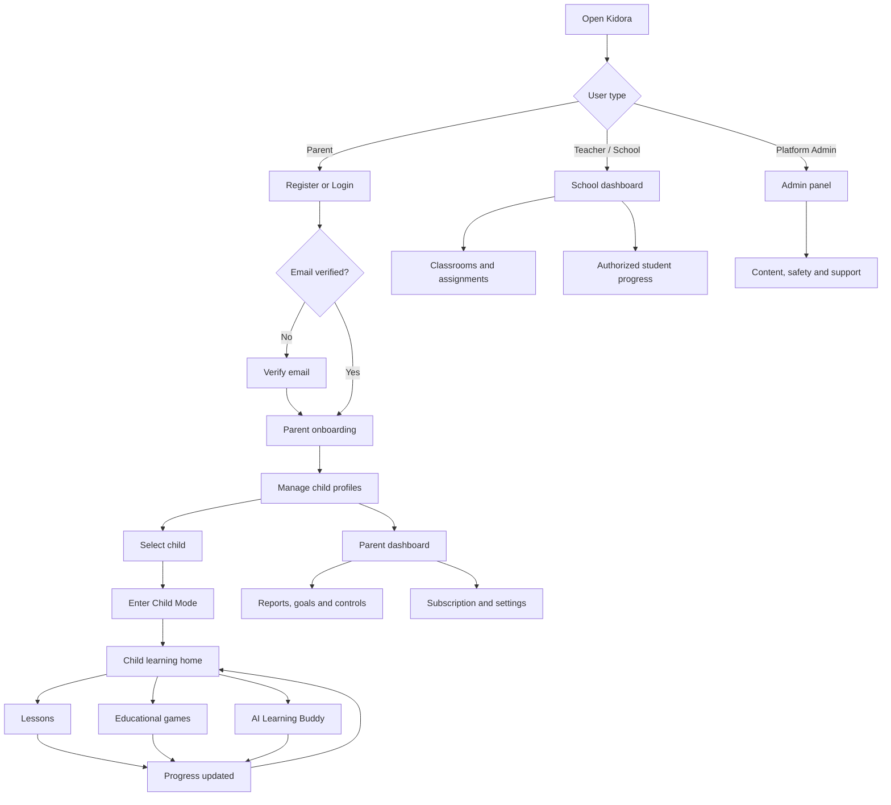
3. High-level system architecture
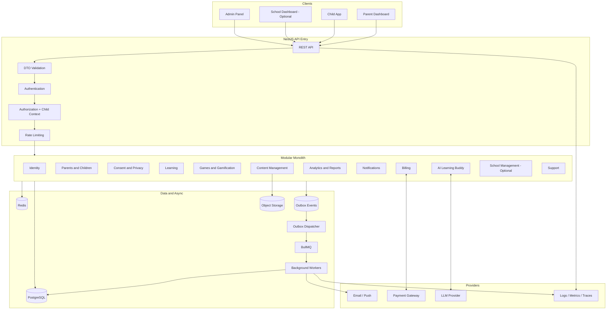
Architecture principles 1. Start with a Modular Monolith, not
microservices. 2. PostgreSQL is the transactional source of truth. 3.
Redis supports caching, rate limits, ephemeral state, and BullMQ---not
primary business storage. 4. Use workers for non-interactive tasks. 5.
Write business data and its Outbox event in the same database
transaction. 6. Keep AI behind an application boundary so providers can
change. 7. School functionality remains optional until the launch scope
is decided. 8. Avoid Kafka/Kubernetes until real scale or operational
needs justify them.
4. Backend request lifecycle
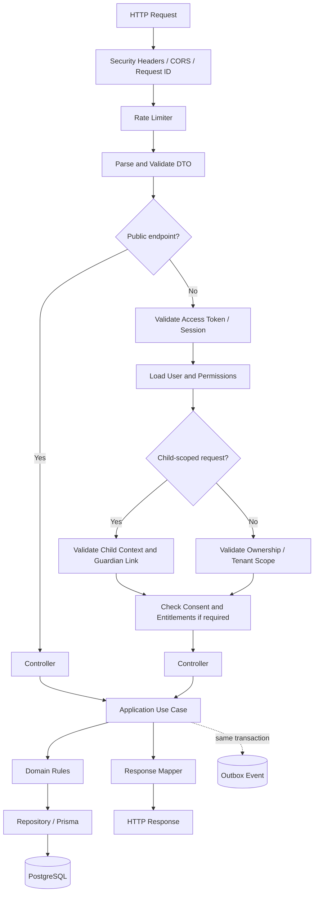
5. Main data flow and Outbox pattern
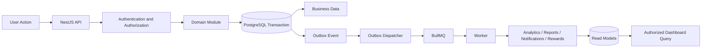
The domain transaction writes both business data and the Outbox event
atomically. A dispatcher later publishes pending events to BullMQ.
Consumers must be idempotent because delivery can happen more than once.
6. Core sequence diagrams
6.1 Parent registration and email verification
```mermaid
sequenceDiagram
    autonumber
    actor Parent
    participant Client
    participant API
    participant Auth as Identity Module
    participant DB as PostgreSQL
    participant Outbox
    participant Worker
    participant Email as Email Provider
    Parent->>Client: Submit registration
    Client->>API: POST /auth/register
    API->>Auth: Register parent
    Auth->>DB: Check email uniqueness
    Auth->>Auth: Hash password and verification token
    Auth->>DB: Create PENDING_VERIFICATION user + token hash
    Auth->>DB: Insert VerificationEmailRequested Outbox event
    Auth-->>Client: Registration accepted; check email
    Outbox->>Worker: Dispatch email job
    Worker->>Email: Send verification link
    Parent->>Client: Open verification link
    Client->>API: POST /auth/verify-email
    API->>Auth: Verify token
    Auth->>DB: Validate hash, expiry, unused state
    Auth->>DB: Mark token used and user ACTIVE
    Auth-->>Client: Email verified
```
6.2 Parent login and refresh token rotation
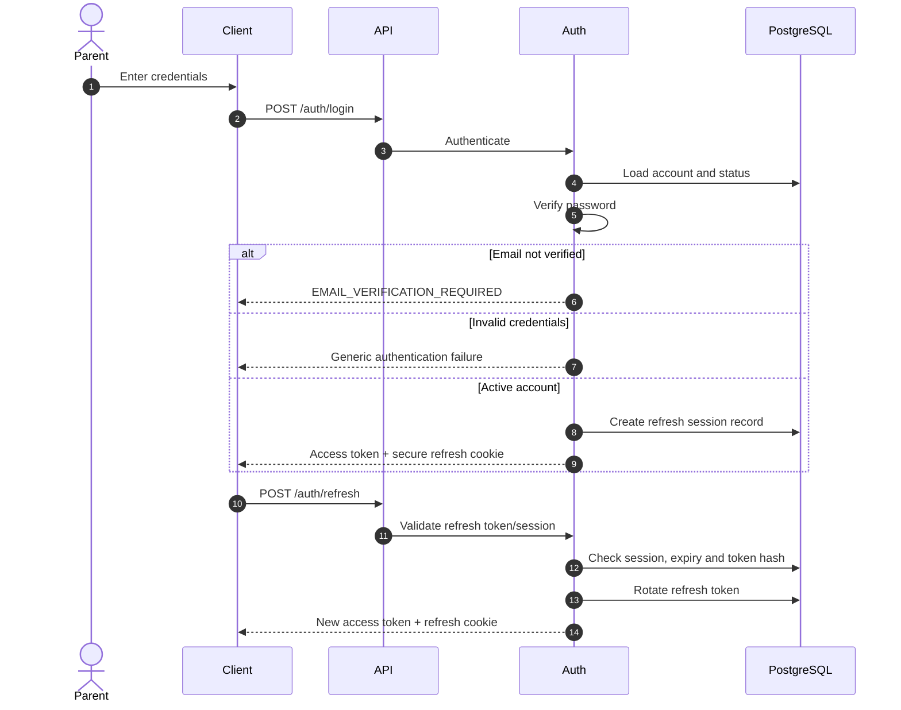
6.3 Parent selects child / enters Child Mode
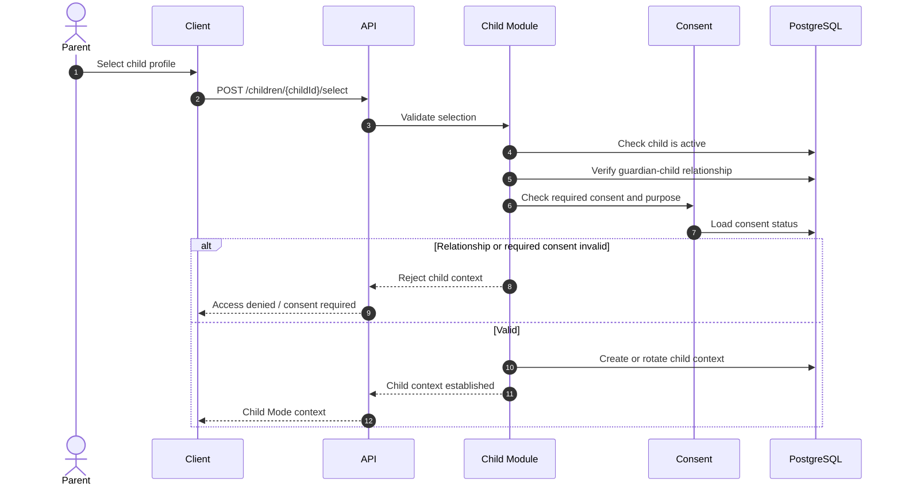
6.4 Learning session and answer evaluation
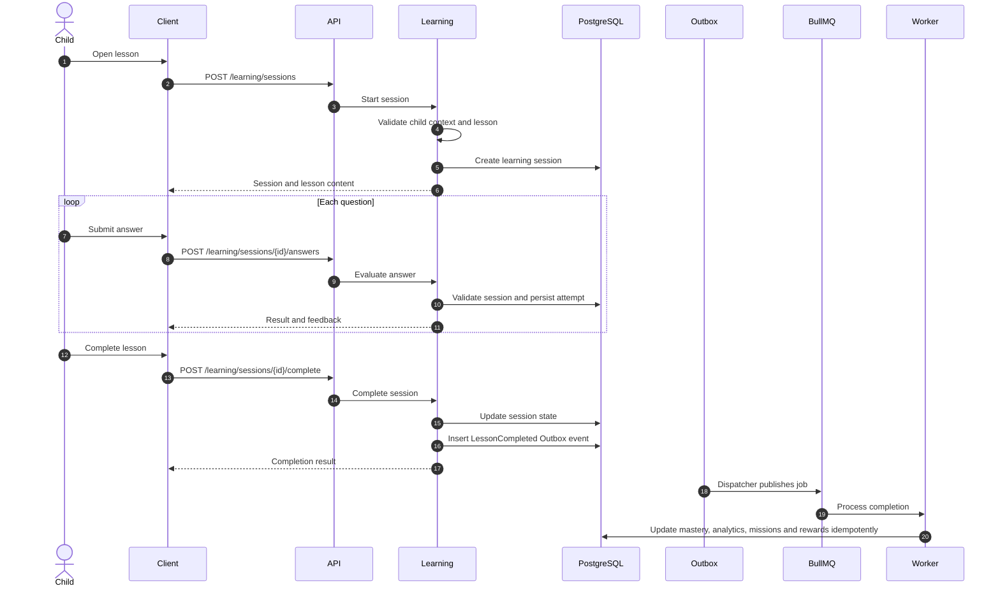
6.5 Game session and reward ledger
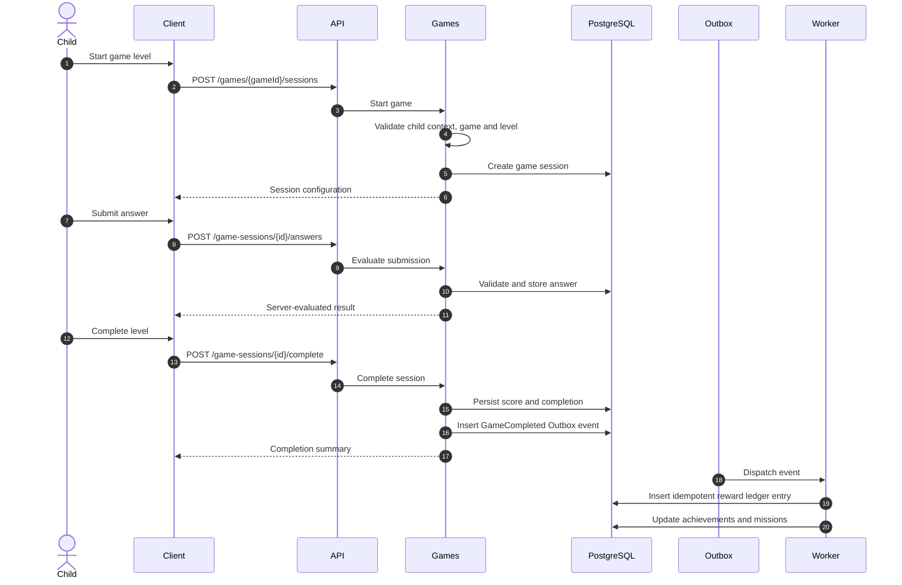
6.6 AI Learning Buddy
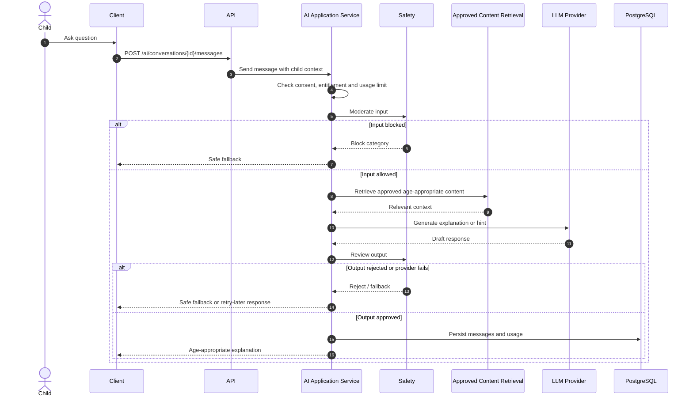
6.7 Parent report generation
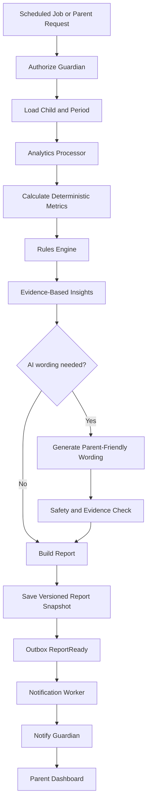
Report content: overall progress, repeated strengths, areas for
practice, trends, parent guidance, next goals, and achievements. Metrics
must come from actual data. Compare the child with their own previous
performance, not harmful public rankings. AI must not diagnose a child
or invent evidence.
6.8 Subscription and payment webhook
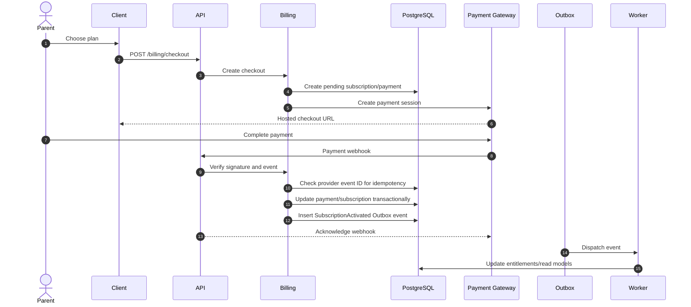
Never trust the browser redirect as proof of payment. Verify webhook
signatures and process provider event IDs idempotently. Renewal, retry,
refund, grace period, and cancellation timing need product decisions.
6.9 Outbox dispatcher and worker
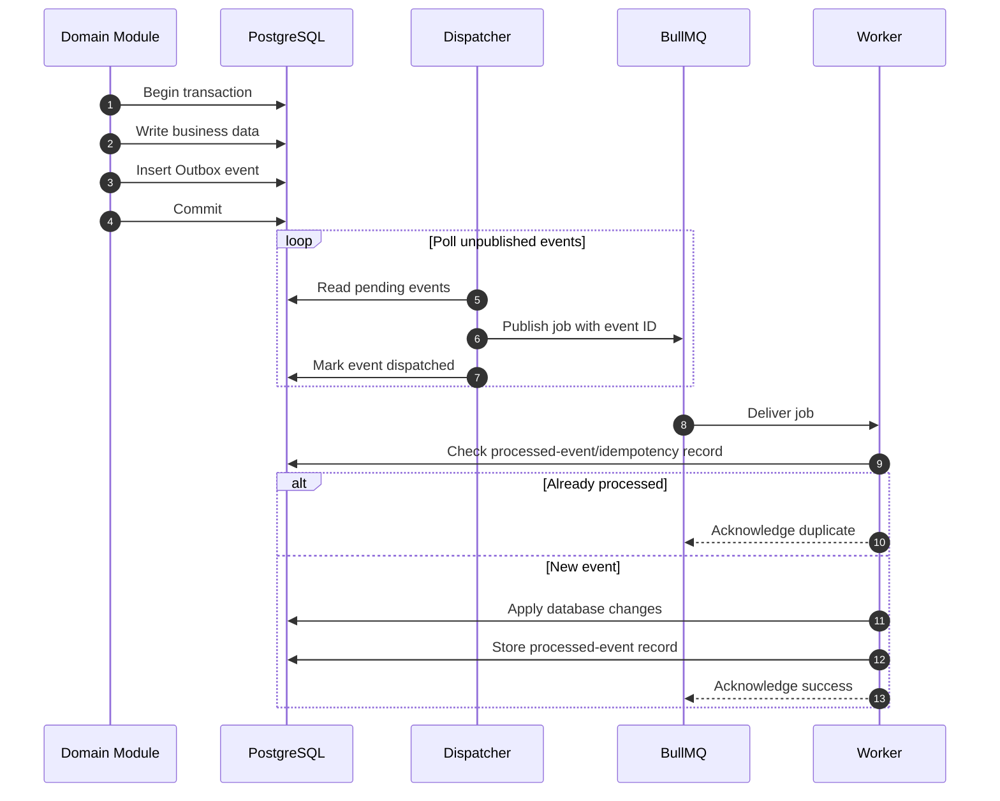
Use bounded exponential backoff with jitter, idempotent handlers,
failed-job handling, and alerts for old unpublished events or repeated
failures.
7. Workflow inventory
This is a planning inventory, not a promise that all items are MVP
scope.
  Domain                              Workflows
  Identity                            Register, verify email, resend
verification, login, refresh,
logout, forgot/reset password,
revoke all sessions

  Parent                              Onboarding, update profile, manage
settings

  Child                               Add/view/update/deactivate child,
select child, switch child

  Consent & Privacy                   Record consent, withdraw consent,
export data, delete account/data,
apply retention policy

  Learning                            Browse catalog, start/resume
session, submit answer, complete
lesson, assess skill, update
mastery

  Games                               Browse games, start session, submit
answer, complete game

  Gamification                        Award points, unlock achievement,
update mission

  AI                                  Start conversation, send question,
generate hint, moderate
input/output, provider
failure/fallback

  Parent Reports                      View dashboard/history, generate
report/insights, set and track
goals

  Notifications                       Create, deliver, track, retry
failed delivery

  Billing                             Subscribe, webhook, renew, payment
failure, cancel, refund

  School (optional)                   Create tenant, invite teacher,
manage classroom, enroll child,
assign lesson, view authorized
progress

  Content                             Create/update content, review
AI-generated content,
publish/reject

  Support                             Create ticket, assign/handle
ticket, close ticket

  Operations                          Process Outbox, retry failed jobs,
scheduled analytics, data retention
Security                            Audit sensitive action, rate-limit
and abuse handling
8. Suggested backend module structure
src/
├── main.ts
├── app.module.ts
├── common/
│   ├── decorators/
│   ├── guards/
│   ├── interceptors/
│   ├── filters/
│   ├── pipes/
│   ├── middleware/
│   ├── exceptions/
│   ├── constants/
│   ├── interfaces/
│   ├── utils/
│   └── types/
├── core/
│   ├── config/
│   ├── database/
│   ├── prisma/
│   ├── redis/
│   ├── queue/
│   ├── logger/
│   ├── events/
│   └── observability/
├── modules/
│   ├── identity/
│   ├── parents/
│   ├── children/
│   ├── consent/
│   ├── learning/
│   ├── games/
│   ├── gamification/
│   ├── ai-learning-buddy/
│   ├── analytics/
│   ├── parent-reports/
│   ├── notifications/
│   ├── billing/
│   ├── content/
│   ├── schools/       # Optional / phase-dependent
│   └── support/
└── workers/
    ├── email/
    ├── notifications/
    ├── analytics/
    ├── reports/
    ├── gamification/
    └── ai/
Internal structure of a module
learning/
├── presentation/       # Controllers, DTOs, guards, mappers
├── application/        # Use cases, commands, queries, services
├── domain/             # Entities, value objects, rules, events
├── infrastructure/     # Repositories, Prisma, external providers
└── learning.module.ts
Create folders when needed; avoid empty architecture scaffolding.
9. Initial data model --- draft
Not a finalized schema. Confirm scope, constraints, retention, and
authorization before migrations.
  Domain                              Candidate tables
  Identity                            users, auth_identities,
refresh_sessions, roles,
user_role_assignments,
permissions

  Parent/Child                        parent_profiles,
child_profiles,
guardian_child_links,
child_contexts

  Consent                             consents, consent_versions or
consent evidence fields

  Learning                            subjects, skills,
skill_prerequisites, lessons,
lesson_skills, questions,
learning_sessions, attempts,
skill_assessments,
skill_mastery

  Games                               games, game_levels,
game_skills, game_sessions,
game_answers, game_events

  Gamification                        achievements,
child_achievements, missions,
mission_progress, reward_ledger

  AI                                  ai_conversations, ai_messages,
ai_usage_records,
ai_content_reviews

  Recommendations                     recommendations,
recommendation_feedback

  Analytics/Reports                   learning_analytics,
learning_goals, parent_reports,
report_skill_insights,
report_recommendations,
parent_action_items

  Notifications                       notifications,
notification_preferences,
notification_deliveries

  Billing                             plans, plan_features,
subscriptions, invoices,
payment_transactions,
payment_provider_events

  School (optional)                   tenants, tenant_memberships,
schools, classrooms,
classroom_teachers,
classroom_enrollments,
lesson_assignments
Operations                          outbox_events,
processed_events,
job_executions, audit_logs,
support_tickets
Data design notes - Enforce tenant and guardian-child isolation on
every relevant query. Composite keys and PostgreSQL RLS can provide
defense in depth. - entity_type + entity_id polymorphic references are
not real foreign keys; use typed references or explicit integrity rules
where needed. - Keep immutable historical assessments separate from the
latest skill_mastery projection. - Use JSONB for flexible
configuration only, not as a substitute for relational modeling. -
Decide whether subjects/skills are global catalog data and who owns
lessons. - Keep reward ledger append-only, with idempotency keys and
reversal entries. - Define analytics granularity, timezone handling, and
unique aggregation keys. - Do not create all proposed tables in the MVP.
10. Security, privacy and child safety
- Obtain and record legally appropriate guardian consent for required
  purposes.
- Minimize child data collection and define retention/deletion rules.
- Enforce guardian-child checks on every parent read/write.
- Enforce child context on every child-scoped operation.
- Enforce tenant scope for school-owned resources.
- Hash passwords and one-time tokens; never store raw
  reset/verification tokens.
- Use secure HttpOnly cookies and refresh-token rotation.
- Rate-limit login, registration, resend, reset, AI, and abuse-prone
  endpoints.
- Audit sensitive actions: consent changes, child-profile access,
  export, deletion.
- Moderate AI inputs and outputs; retrieve only approved
  age-appropriate content.
- Never expose raw child data to teachers or other guardians without
  authorization.
- AI insights must be evidence-grounded and must not diagnose
  children.
11. Observability and reliability
Proposed tools: Pino, Sentry (or equivalent), OpenTelemetry,
Prometheus/Grafana, k6, Jest, Supertest.

Monitor: - API p50/p95/p99 latency, request rate, error rate. - Database
query latency and connection-pool saturation. - Redis health and
latency. - Queue depth, oldest waiting job, retries, failed jobs. -
Outbox backlog and oldest unpublished event. - Email/push delivery
success. - AI latency, failures, token usage, and cost. - Payment
webhook verification failures and processing delay.

Use timeouts for external calls, bounded retries with exponential
backoff and jitter, idempotency keys, database transactions, graceful
degradation, backups, and tested restore procedures.
12. Example API endpoints
Illustrative only; finalize contracts during API design.
  Method                  Endpoint                                       Purpose
  POST                    /auth/register                               Register parent

  POST                    /auth/verify-email                           Verify parent email

  POST                    /auth/resend-verification                    Resend verification

  POST                    /auth/login                                  Parent login

  POST                    /auth/refresh                                Rotate refresh token

  POST                    /auth/logout                                 Revoke current session

  POST                    /auth/forgot-password                        Start reset

  POST                    /auth/reset-password                         Complete reset

  GET                     /children                                    List guardian's
children

  POST                    /children                                    Create child profile

  PATCH                   /children/:childId                           Update child

  POST                    /children/:childId/select                    Enter Child Mode

  GET                     /subjects                                    Browse subjects

  GET                     /lessons/:lessonId                           View lesson

  POST                    /learning/sessions                           Start session

  POST                    /learning/sessions/:sessionId/answers        Submit answer

  POST                    /learning/sessions/:sessionId/complete       Complete lesson

  GET                     /games                                       Browse games

  POST                    /games/:gameId/sessions                      Start game

  POST                    /game-sessions/:sessionId/answers            Submit game answer

  POST                    /game-sessions/:sessionId/complete           Complete game

  POST                    /ai/conversations                            Start AI conversation

  POST                    /ai/conversations/:conversationId/messages   Send AI message

  GET                     /parent/children/:childId/dashboard          Authorized child
dashboard

  GET                     /parent/children/:childId/reports            List reports

  POST                    /billing/checkout                            Create checkout
POST                    /webhooks/payments/:provider                 Payment webhook
For every endpoint define authentication, permissions, child/tenant
scope, consent, DTOs, response, status codes, idempotency, rate limits,
and audit requirements.
13. Testing strategy
- Unit: domain rules, answer evaluation, mastery calculation,
  rewards, consent, entitlements, AI fallback.
- Integration: repositories, transactions, Outbox, guardian-child
  authorization, tenant isolation, token rotation/replay, payment
  webhook idempotency, worker handlers.
- E2E: register → verify → login; create/select child; complete
  lesson; complete game and award once; parent reads only own child's
  report; AI safe response/fallback; payment webhook activates
  entitlement once.
- Load/resilience: catalog reads, answer submissions, dashboards,
  AI limits/timeouts, queue backlog, worker recovery, DB saturation.
14. Suggested implementation phases
1. Foundation: identity, verification, parent, child,
   guardian-child link, consent, authorization, audit basics.
2. Core learning: catalog, lessons, questions, sessions, attempts,
   evaluation, basic parent dashboard.
3. Engagement: built-in games, server-side scoring, reward ledger,
   achievements, missions.
4. AI support: conversations, approved-content retrieval,
   input/output safety, usage limits, fallback, cost monitoring.
5. Reports and operations: analytics, reports, goals,
   notifications, workers, operational dashboards.
6. Expansion: subscriptions/payments and school/tenant features if
   validated.
Do not implement every module just because it appears in this document.
Choose MVP scope based on validation, legal requirements, delivery
capacity, and business priorities.
15. Open product decisions
1. Are schools/teachers in the first MVP, or is launch family-only?
2. What guardian consent purposes are required, and what happens when
   consent is withdrawn?
3. Which child profile fields are essential?
4. Which features are free vs paid, and are limits per family, child,
   or usage?
5. Does cancellation take effect immediately or at the end of the paid
   period?
6. What payment retry schedule or grace period applies?
7. What refund policy must be supported?
8. What AI usage/session limits apply?
9. Which content is authored, AI-generated, reviewed, and published?
10. Which report metrics are essential for the first release?
11. Can multiple guardians access a child, and what can each do?
12. What is the data export/deletion policy?
16. Workflow specification template
Use this before implementing each workflow:
Workflow Name:

1. Business Goal
2. Trigger
3. Actors
4. Preconditions
5. Main Flow
6. Alternative Flows
7. Failure Scenarios
8. Business Rules
9. Components Involved
10. Database Operations and Transaction Boundaries
11. Events and Background Jobs
12. Security and Authorization
13. API Contracts
14. Sequence Diagram
15. Test Scenarios
For every feature ask: Who? What? Why? When? Where? How? What if?

Recommended engineering order:

Business Goal → Actors & Permissions → Business Rules → Data
Requirements → System Flow → Failure Scenarios → API Design →
Implementation → Testing → Observability
17. Working notes
- Diagrams use Mermaid and can be rendered directly by GitHub
  Markdown.
- Keep this file updated as decisions change.
- Mark features MVP, Later, or Out of Scope after scope is
  agreed.
- Convert each workflow into a detailed specification b
